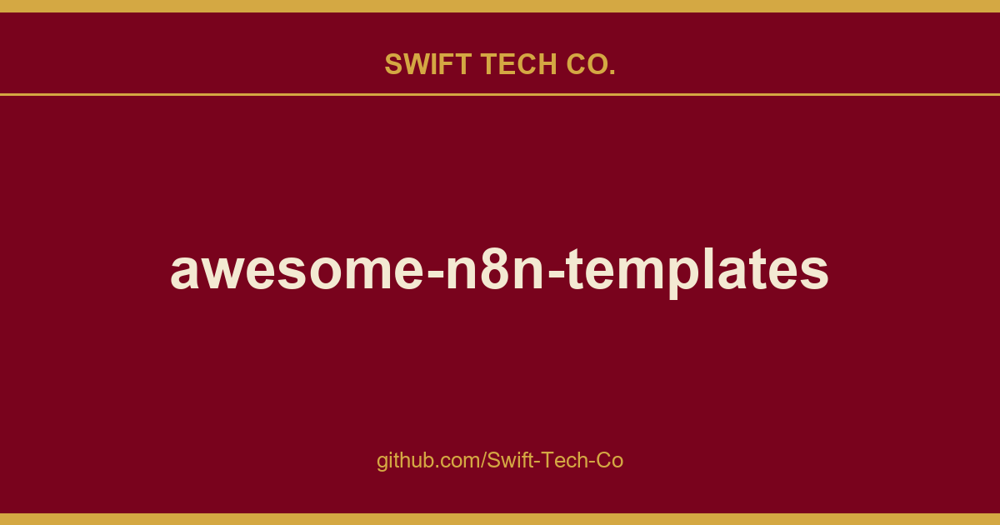

# awesome-n8n-templates

## What This Is

Every project needs a shelf of ready answers. product and engineering is one of those shelves, and awesome-n8n-templates is the entry on it - the notes, patterns and fixes we reuse when this kind of work comes up.

## Images

## Sources

Compiled and maintained from upstream [enescingoz/awesome-n8n-templates](https://github.com/enescingoz/awesome-n8n-templates) under permissive open-source license.

---

Maintained by [Swift Tech Co.](https://github.com/Swift-Tech-Co) - [Telegram](https://t.me/+Qt_eFvkb2rliMzNh)